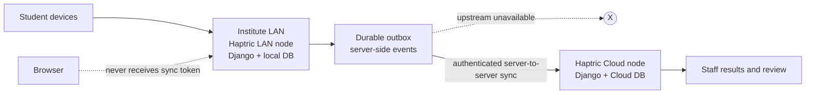

# Haptric

Haptric is an open-source exam platform for schools, coaching institutes, and learning communities that keeps an exam running on the institute LAN when upstream internet/cloud connectivity fails, then synchronizes the trusted result safely.

## The problem

Cloud-only exam tools make a weak internet connection a hard stop. Students lose access, staff lose visibility, and a retry can create duplicate submissions.

## The solution

Haptric runs the exam workflow on a local Django node. Attempts, answers, deadlines, and scores are persisted locally first. A durable, authenticated outbox delivers supported events to Cloud when connectivity returns. Replaying sync is safe and conflicts are explicit.

## What works

- Django session authentication with CSRF protection and role-aware access.
- Organization isolation for staff, students, exams, attempts, and results.
- Staff exam authoring, student provisioning, assignment, publishing, and review.
- Student attempts with persisted answers, server deadlines, expiry, scoring, and results.
- Staff question-by-question attempt review with answer-key privacy on student endpoints.
- Hybrid LAN/Cloud synchronization with bounded retries, idempotent replay, and conflict detection.

## Architecture



"Offline" here means the upstream Cloud node is unavailable while the student browser can still reach the institute LAN. Haptric is not a browser-offline/PWA engine.

## Standard local setup (Windows PowerShell)

```powershell
py -3.12 -m venv .venv
.venv\Scripts\python.exe -m pip install -r backend\requirements.txt
.venv\Scripts\python.exe backend\manage.py migrate
.venv\Scripts\python.exe backend\manage.py runserver 127.0.0.1:8000
```

In another terminal:

```powershell
Set-Location frontend
npm install
npm run dev -- --host 127.0.0.1
```

Open `http://127.0.0.1:5173/`. Create disposable local users through the provisioning API or the hybrid demo seed script; never commit their passwords.

## Test Haptric locally

For verified browser pages, API paths, disposable demo accounts, the normal
staff/student walkthrough, and the LAN/Cloud outage rehearsal, see
[docs/LOCAL_TESTING.md](docs/LOCAL_TESTING.md).

Shortest demo setup:

```powershell
$env:HAPTRIC_DEMO_PASSWORD = 'choose-a-local-only-password'
$env:HAPTRIC_SYNC_TOKEN = 'choose-a-local-only-token'
.\tools\demo\setup-hybrid-demo.ps1
.\tools\demo\seed-hybrid-demo.ps1
```

Then start the LAN backend with `tools\demo\start-lan.ps1`, start the Vite
frontend on port 5173, and open `http://127.0.0.1:5173/`.

## Hybrid demo

The complete judge runbook is in [docs/HACKATHON_DEMO.md](docs/HACKATHON_DEMO.md). The reproducible PowerShell scripts in `tools/demo/` create separate disposable SQLite databases:

```powershell
$env:HAPTRIC_DEMO_PASSWORD = 'choose-a-local-only-password'
$env:HAPTRIC_SYNC_TOKEN = 'choose-a-local-only-token'
.\tools\demo\setup-hybrid-demo.ps1
.\tools\demo\seed-hybrid-demo.ps1
.\tools\demo\start-cloud.ps1       # 127.0.0.1:8001
.\tools\demo\start-lan.ps1         # 127.0.0.1:8000
.\tools\demo\hybrid-demo-check.ps1
```

Start the Cloud frontend on port 5174 when demonstrating the recovered result. Stop the Cloud terminal to simulate the outage, let the student finish on LAN, restart Cloud, then run `sync-lan.ps1`. `reset-hybrid-demo.ps1` removes only the known `.demo-hybrid` databases.

## Tests

Run the release checks from the repository root:

```powershell
.venv\Scripts\python.exe backend\manage.py check
.venv\Scripts\python.exe -m pytest tests\backend tests\qa -q
Set-Location frontend
npm install
npm run lint
npm run test -- --run
npm run build
```

The latest verified run is recorded in [docs/HACKATHON_RELEASE.md](docs/HACKATHON_RELEASE.md). Docker/PostgreSQL were unavailable in that environment, so the two-node rehearsal uses isolated SQLite stores and does not claim PostgreSQL verification.

## Security model

Browser sessions use Django session authentication and CSRF protection. Every business read/write is organization-scoped. Student responses redact answer keys and marking internals. Sync ingestion is server-to-server traffic authenticated by an environment token, with schema, size, origin, and organization checks. The token is never sent to React.

## Limitations

- Not browser-offline/PWA; the browser must reach the LAN node.
- Cloud reference data is seeded/provisioned on both nodes for the MVP demo.
- Synchronization is a bounded/manual command, not a production scheduler.
- Production token rotation, signed envelopes, and PostgreSQL two-node verification remain future work.

## Demo and release material

- [Judge demo script](docs/HACKATHON_DEMO.md)
- [Fast recovery guide](docs/DEMO_RECOVERY.md)
- [Judge FAQ](docs/JUDGE_FAQ.md)
- [Release checklist](docs/HACKATHON_RELEASE.md)
